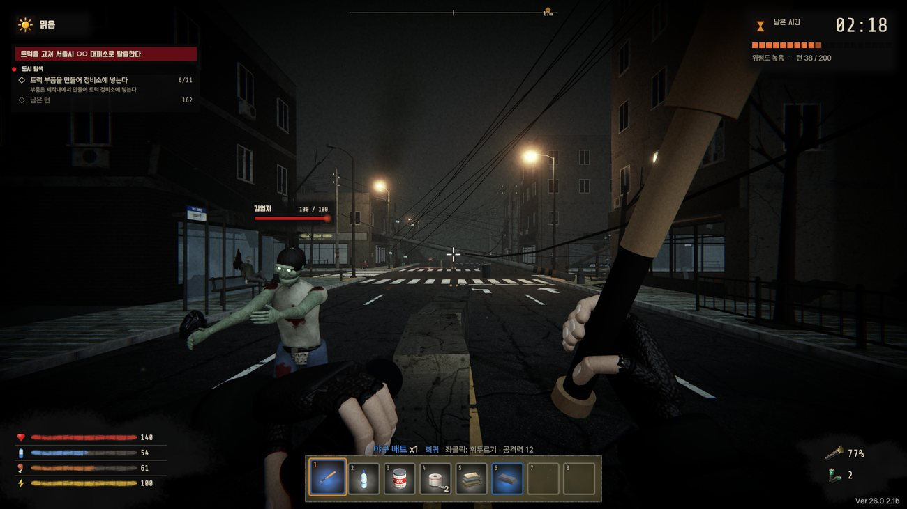
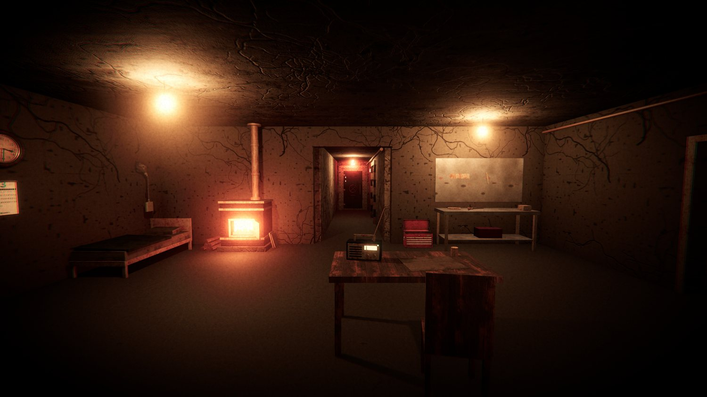
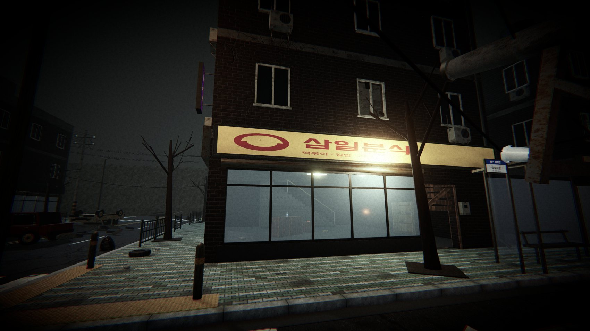

# 벙커랩 (BUNKER LAB)

**"더 챙길까, 지금 돌아갈까?"**

서울 민방위 대피소를 나와 5분씩 폐허를 뒤지는 1인칭 생존 공포 게임

- 팀: Team_31 벙커랩 (AI:ON 2026, T-2026-0031)
- 플랫폼: PC (Windows 64비트)
- 현재 버전: **26.0.2.1** (BETA_VER) — 변경 내역은 [PATCH_NOTES.md](PATCH_NOTES.md), 게임 안에서는 메인 메뉴 맨 아래 **패치노트**
- 엔진: Unity 6.3 (6000.3.x) · URP · Input System

## 어떤 게임인가요?

평범한 오후, 수도권에 핵 공격이 일어납니다. 주인공은 서울의 민방위 대피소(방공호)로 겨우 몸을 피합니다. 하지만 밖은 폐허가 되었고, 정체 모를 바이러스에 걸린 감염자들이 거리를 돌아다닙니다.

살아남으려면 먹을 것과 재료를 구하러 밖으로 나가야 합니다. 한 번 나가면 **5분** 안에 돌아와야 합니다. 시간을 넘기면 하늘이 붉게 물들고 체력이 계속 줄어듭니다. 많이 챙길수록 짐이 무거워져 걸음이 느려지고, 죽으면 저장한 기록이 사라집니다. 그래서 나갈 때마다 같은 고민을 하게 됩니다.

**더 챙길까, 지금 돌아갈까?**

최종 목표는 **트럭을 고쳐 이 도시를 탈출하는 것**입니다.

## 어떻게 플레이하나요?

1. **방공호에서 준비하기**: 제작대에서 장비를 만들고, 음식을 먹고, 발전기에 연료를 넣습니다.
2. **5분 동안 도시 뒤지기**: 건물 안에서 쓸 만한 물건을 찾고, 감염자를 피하거나 맞서 싸웁니다.
3. **시간 안에 돌아오기**: 돌아오면 자동으로 저장됩니다. 침대에서 자고 다음 탐험을 준비합니다.
4. **트럭 고치기**: 모은 재료로 부품을 만들어 트럭 정비소에 넣습니다. 부품 11개를 모두 넣으면 탈출합니다.

나가고, 돌아오고, 잠을 잘 때마다 1턴이 지나며 게임은 최대 200턴까지 이어집니다. 처음 하는 사람은 화면 왼쪽 위의 할 일 안내를 따라가면 됩니다.

## 이 게임의 특징

- **혼자, 짧게 즐길 수 있습니다.** 탐험 한 번이 5분이고, 방공호에 돌아올 때마다 자동으로 저장됩니다.
- **한국의 동네가 무대입니다.** 민방위 대피소, 상가 간판, 아파트 단지, 횡단보도와 전봇대가 있는 길거리가 폐허로 변했습니다. 가게 이름은 모두 우리 팀 번호 31에서 따왔습니다. (31편의점, 삼일약국, 삼일아파트)
- **편하기만 한 선택은 없습니다.** 어두워서 손전등이 필요하지만, 켜면 감염자가 더 멀리서 알아챕니다. 달리면 소리가 커지고, 앉아서 걸으면 조용합니다. 발전기 전력이 바닥나면 방공호 문이 열리고 감염자가 들어옵니다.
- **싸우기보다 피하는 판단이 중요합니다.** 적은 감염자 4종과 들개, 약탈자까지 6종입니다. 턴이 쌓일수록 새로운 적이 섞이고 쫓아오는 속도도 빨라집니다.
- **직접 만들어 쓰는 재미가 있습니다.** 아이템 41종과 조합법 26종이 있습니다. 찾아온 재료로 무기와 방어구, 트럭 부품을 만듭니다.

|  |  |
|:---:|:---:|
| **방공호**: 쉬고, 만들고, 다음 탐험을 준비하는 곳 | **도시**: 폐허가 된 한국의 동네 길거리 |

## 지금 상태

메인 메뉴부터 탈출 엔딩까지 한 판의 흐름이 이어지는 베타 버전입니다. 아직 남은 일도 있습니다.

- 트럭을 완성하는 데 재료가 너무 많이 들어서, 처음부터 끝까지 해 보는 시험을 아직 하지 못했습니다.
- 200턴을 버텼을 때의 결말과 탈출 목적지의 이름(서울시 ○○)은 아직 임시입니다.
- 외부 테스터의 평가를 아직 받지 못했고, 저사양 PC에서의 성능도 재 보지 않았습니다.

## 바로 플레이하기

1. [Releases](../../releases) 맨 위에 있는 가장 새로운 버전의 `UNIV_GAMEDEV_<버전>.zip`을 받아 압축을 풉니다.
2. `UNIV_GAMEDEV.exe`를 실행합니다. 서명되지 않은 실행 파일이라 Windows 경고가 뜨면 **추가 정보 → 실행**을 누릅니다.
3. **새 게임**을 고르면 시작됩니다. 첫 장면은 Esc로 건너뛸 수 있습니다. 소리가 중요한 게임이라 헤드폰을 권합니다.

## 조작

| 키 | 동작 |
|---|---|
| W A S D / 마우스 | 이동 / 시점 |
| Shift / C / Space | 달리기(스태미나 소모) / 앉기 / 점프 |
| F | 줍기 · 문 · 시설 사용 |
| Q / R | 손전등 꺼내기·넣기 / 배터리 갈아 끼우기 |
| 1~8 · 휠 / 우클릭 / G | 핫바 선택 / 사용 / 버리기 |
| 좌클릭 | 공격 (둔기를 고르면 더 강함) |
| E / Esc | 소지품 / 일시정지 |

키는 게임 안의 **설정 → 컨트롤**에서 바꿀 수 있습니다.

## 프로젝트 열기

> 프로젝트에 Unity MCP(MCP for Unity) 패키지가 Git 주소로 들어 있어서, 프로젝트를 열 PC에는 [Git](https://git-scm.com)이 설치되어 있어야 합니다.

1. Unity Hub에서 이 폴더를 **Add project**로 추가하고 Unity 6000.3.x로 엽니다. (첫 실행 시 `Library` 폴더를 다시 만드느라 몇 분 걸립니다)
2. `Assets/Scenes/MainMenu.unity`를 열고 ▶ 플레이

## 폴더 구조

| 경로 | 내용 |
|---|---|
| `Assets/Scripts/Core` | 게임 진행(턴·상태·씬 이동), 저장(`SaveSystem`), 아이템·등급·조합법, 밸런스, 설정 |
| `Assets/Scripts/Player` | 이동·스테미너, 상호작용, 손전등, 공격, 손 모델, 핫바 |
| `Assets/Scripts/Shelter` | 방공호 시설 (출입구·제작대·창고·침대·발전기·조명·라디오), 정전 때 좀비 침입(`ShelterInvasion`·`BlastDoor`) |
| `Assets/Scripts/City` | 도시 탐험 진행, 좀비 4종·약탈자(`Zombie`·`ZombieLooks`), 원거리 투사체, 들개, 잡상인, 해치 |
| `Assets/Scripts/UI` | HUD, 메뉴, 설정, 아이콘, 도입 컷씬, 제작대 화면 |
| `Assets/Scripts/World` | 문, 바닥 아이템(줍기), 아이템 모양, 깜빡이는 조명 |
| `Assets/Scripts/Audio` | 코드로 합성하는 효과음 |
| `Assets/Editor/GameSceneBuilder*.cs` | 씬·프리팹·머티리얼 자동 생성 도구 (공통 / `.Prefabs` / `.Shelter` / `.City` / `.Menu` / `.Cutscene`) |
| `Assets/Resources/Cutscene` | 새 게임 도입 컷씬 사진 3장 (`cut1~3.png`, 1920×1080) |
| `Assets/Resources/ItemIcons` | 2D 아이템 아이콘 (`ItemDatabase.cs`의 `icon:` 이름과 같은 파일명) |
| `Assets/Resources/GameBalance.asset` | **밸런스 수치** (인스펙터에서 수정) |
| `Assets/Resources/PatchNotes.json` | 게임 안 패치노트 (버전별 추가·수정·패치 사항) |
| `Assets/SurvivalInventory` | 등급·아이콘이 있는 새 인벤토리 UI (UI Toolkit). 지금은 `Demo/InventoryDemo` 씬에서만 사용, 자세한 내용은 폴더 안 README |

## 자주 하는 작업

- **밸런스 조정**: `Assets/Resources/GameBalance.asset`을 선택하고 인스펙터에서 숫자를 바꿉니다.
- **아이템·조합법·거래 추가**: `Assets/Scripts/Core/ItemDatabase.cs` (도시에 떨어지게 하려면 같은 파일의 `LootWeights`에도 추가). 새 아이템의 모양은 `Assets/Scripts/World/ItemVisuals.cs`에 추가하며, 없으면 회색 상자로 보입니다.
- **씬 다시 만들기**: 메뉴 `Tools > 핵폭발 생존 > 게임 씬 전체 생성` — MainMenu·Shelter·City 씬과 함께 `Assets/Prefabs`(Player·Zombie·Dog), `Assets/Materials/Game`, `Assets/Settings`의 포스트 프로세싱 프로필, `Assets/Generated` 메시·내비메시, URP 설정, Build Settings 씬 목록을 새로 만듭니다. 이것들을 손으로 고친 내용은 사라지므로, 바꾸고 싶으면 `Assets/Editor/GameSceneBuilder*.cs`를 고치세요. (`GameBalance.asset`은 없을 때만 만들어서 팀이 고친 값은 유지됩니다)
- **컷씬 사진 다시 만들기**: 메뉴 `Tools > 핵폭발 생존 > 컷씬 이미지 생성`. 직접 그린 그림으로 바꾸려면 `Assets/Resources/Cutscene/cut1~3.png`를 같은 이름으로 덮어쓰면 됩니다. 자막은 `Assets/Scripts/UI/UIManager.Cutscene.cs`의 `CutShots`.
- **아이템 아이콘·등급 바꾸기**: 아이콘은 `Assets/Resources/ItemIcons`에 PNG를 넣고 `ItemDatabase.cs`에서 그 아이템의 `icon:` 이름을 적습니다. 등급 색은 `ItemRarityInfo.Color`, 칸 배경은 `Assets/SurvivalInventory/Resources/SurvivalInventory/Rarity`.
- **저장 파일**: `%USERPROFILE%\AppData\LocalLow\DefaultCompany\UNIV_GAMEDEV\save.json` (지우면 처음부터)
- **버전 올리기**: `Edit > Project Settings > Player > Version`을 바꾸고, `Assets/Resources/PatchNotes.json` 맨 위에 그 버전 항목(`added` 추가사항 · `changed` 수정사항 · `patched` 패치사항)을 추가한 뒤 빌드합니다. 메인 메뉴의 패치노트 화면이 이 파일을 읽습니다. GitHub용 `PATCH_NOTES.md`도 같은 내용으로 맞춥니다.

## 사용한 에셋

3D 모델 대부분과 UI 그림, 나머지 효과음은 코드로 직접 만들었습니다. 외부 에셋은 자유 라이선스만 썼고, 제작자와 출처 전체 목록은 [Credits/외부_에셋_목록.md](Credits/외부_에셋_목록.md)에 있습니다.

- 텍스처 · 3D 모델: [Poly Haven](https://polyhaven.com) (CC0)
- 감염자 목소리: ianzazz, Darsycho, saturn91 (OpenGameArt, CC0)
- 발소리: Fantozzi, Kenney, Ali_6868 (CC0) / swuing, EminYILDIRIM (CC-BY 3.0)
- 글꼴: Pretendard, Do Hyeon, Nanum Pen Script, Share Tech Mono (SIL Open Font License 1.1) — `Assets/Resources/Fonts`, 라이선스 문서를 함께 넣었습니다
